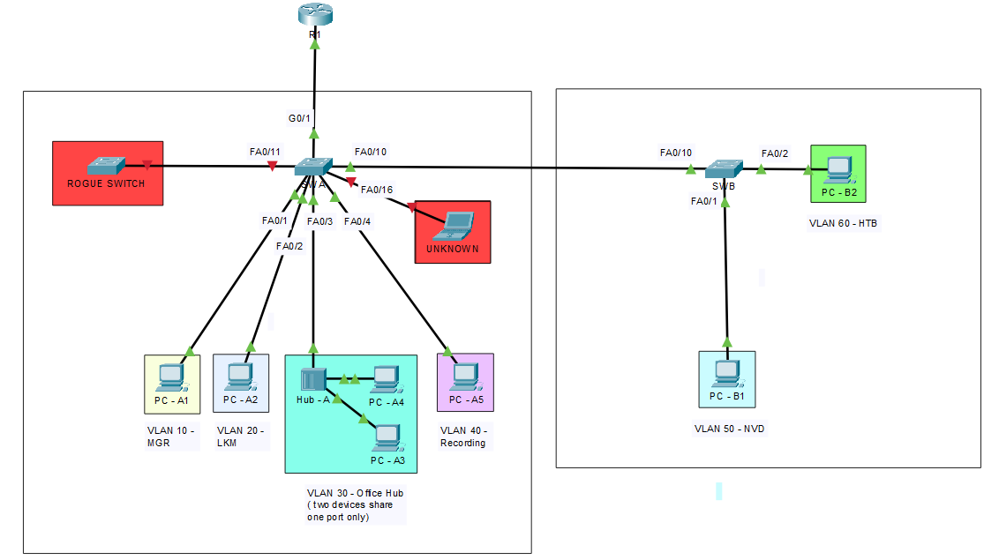

# Packet-Tracer-Project-7.1---Port-Security

---

### A. Scenario

**Company:** Larkspur Logistics (fictional), a regional distribution company.

Last quarter, a visiting contractor plugged a personal laptop into an empty wall jack and joined the staff network for several days without anyone noticing. In the same week, an employee installed a small hub under their desk to share one wall jack with a coworker, and a second employee brought in an unmanaged switch to extend a desk. IT had no visibility into any of it.

The IT security officer issued this directive:

> "Every access port must only accept the devices we expect. If something unexpected shows up, I decide how loudly the switch reacts, from silently dropping traffic to shutting the port down. Ports nobody uses must be dead."

The network engineer (you) is asked to configure the branch access switches so that **only authorized devices can use each port, and each port reacts to unauthorized devices according to the risk of its location.**

---

### B. Why Port Security Matters

A switch builds its MAC address (CAM) table by reading the **source MAC address** of every frame it receives. By default, it trusts whatever it sees.

| Problem | What happens |
|---|---|
| **Unauthorized device** | Anyone can plug into an open port and get network access |
| **MAC flooding** | An attacker sends thousands of frames with fake source MACs. The CAM table fills up and the switch floods frames out of every port, so the attacker can capture other users' traffic |
| **Rogue switch or hub** | Extra devices appear behind a single port without IT's knowledge |

Port Security limits **which** MAC addresses, and **how many**, are allowed on a port, and defines what happens when the limit is broken.

---

### C. Requirements

- Only approved devices may use each access port. 
- The reaction to an unauthorized device must match the risk of the location.
- Approved devices must keep working after a reboot, where the business needs that. 
- Unused wall jacks and switch ports must not provide network access. 
- A shared office port must support exactly two devices behind a hub. 
- IT must be able to see which port was violated and by which MAC. 
- IT must be able to restore a locked-down port quickly once the problem is resolved. 
-Departments must still be able to communicate with each other (through R1).

#### C.1. Security Policies for Each Port in SWA and SWB
##### SWA

| Port | Device | Secure MAC type | Max | Violation | Aging |
|---|---|---|---|---|---|
| Fa0/1 | PC-A1 | **Static** | 1 | `shutdown` | None |
| Fa0/2 | PC-A2 | **Sticky** | 1 | `restrict` | None |
| Fa0/3 | Hub-A (PC-A3, PC-A4) | **Sticky** | 2 | `protect` | None |
| Fa0/4 | PC-A5 | **Dynamic** | 1 | `restrict` | 2 min (absolute) |
| Fa0/10 | SWB | Trunk | None at baseline | n/a | n/a |
| G0/1 | R1 | Trunk | None | n/a | n/a |
| Fa0/5-9, Fa0/11-24, G0/2 | None | n/a | n/a | n/a | Parked in VLAN 672, shut down |

##### SWB

| Port | Device | Secure MAC type | Max | Violation | Aging |
|---|---|---|---|---|---|
| Fa0/1 | PC-B1 | **Static + sticky** | 2 | `shutdown` | None |
| Fa0/2 | PC-B2 | **Sticky** | 1 | `shutdown` | None |
| Fa0/10 | SWA | Trunk | None | n/a | n/a |
| Fa0/3-9, Fa0/11-24, G0/1-2 | None | n/a | n/a | n/a | Parked in VLAN 674, shut down |

##### Why Each Port Uses Its Policy

| Switch | Port | Reasoning |
|---|---|---|
| SWA | Fa0/1 | Management traffic. Only one known device is ever allowed, and anything else should lock the port |
| SWA | Fa0/2 | The switch learns the device itself, and violations are logged without causing an outage |
| SWA | Fa0/3 | Two devices share a hub, so the maximum is 2. A third device is dropped silently |
| SWA | Fa0/4 | The only port where the MAC is forgotten, to demonstrate dynamic learning and aging |
| SWA | Fa0/10 | The port that has a trunk link to SWB, carrying tagged frames from VLAN 50 and 60, and untagged frames from Native VLAN 190 in both switches. |
| SWA | G0/1 | The port that has a trunk link to R1, carrying tagged and untagged frames from all VLANs to the router for Inter-VLAN routing. |
| SWB | Fa0/1 | Only port with a manually entered MAC plus a learned one |
| SWB | Fa0/2 | Same sticky policy as SWA Fa0/2, but with `shutdown` and on a second switch |
| SWB | Fa0/10 | The port that has a trunk link to SWA, carrying tagged frames from VLAN 50 and 60, and untagged frames from Native VLAN 190 in both switches. |
| Unused ports | A shut-down port in a dead-end VLAN gives an intruder neither a link nor a route |

---

#### C.2. Trunk Policies in SWA and SWB

---

### Troubleshooting Commands

| Command | What It Does | When to Use It | How It Differs |
|---|---|---|---|
| `show port-security` | One line per secure port: maximum, current count, violation count, action | First check, to get an overview | Summary only. No MAC addresses |
| `show port-security interface <interface>` | Full detail for one port: status, mode, counts, last source MAC and VLAN | Investigating one violation | Per-port detail |
| `show port-security address` | Every secure MAC with type (SecureConfigured, SecureSticky, SecureDynamic), port, and remaining age | Confirming MAC types and aging | MACs only, without port settings |
| `show mac address-table` | The full CAM table | Confirming where a device was learned | Includes non-secure entries |
| `show interfaces status` | Port state, VLAN, duplex, speed | Spotting `err-disabled` and disabled ports | Layer 1/2 state only |
| `show interfaces trunk` | Trunk ports, native VLAN, allowed VLANs | Checking both ends of a trunk match | Trunk view of the switch |
| `show vlan brief` | VLANs and their ports | Confirming parked ports | VLAN view of the ports |
| `show running-config interface <interface>` | One interface's configuration | Confirming sticky lines were written | Configuration, not live state |

> **NOTE:** In `show port-security interface`, read **Last Source Address:VLAN** to find the MAC that caused the latest violation.

---

### Known Limitations

- Packet Tracer can't generate a real MAC flooding attack.
- The features of port security in Packet Tracer are limited
- Violation counters and syslog details may differ from real hardware.
- Voice VLANs and per-VLAN maximums are not covered.
